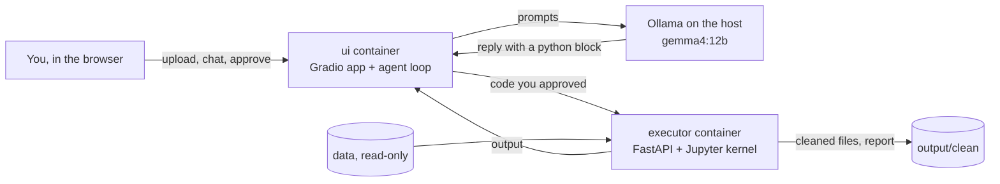

# Cleanup bot

A local data-cleaning agent. Upload CSV files and it checks them for problems, proposes numbered fixes in plain language, and applies **only the fixes you approve**. It then saves the cleaned files with a PDF report of every change and a data dictionary.

Everything runs on your own machine: a local model through [Ollama](https://ollama.com), and every line of model-written code runs in a locked-down Docker sandbox. No data leaves the computer.

## What it does

1. **Checks** each file and every link between files: stray spaces, numbers stored as text, mixed and impossible dates, future dates, placeholder values like `-` or `unknown`, spelling variants, possible abbreviations, duplicate rows, repeated IDs, rows pointing at IDs that don't exist, and outliers, each labelled *likely an error* or *plausible*.
2. **Proposes** a numbered list of fixes and asks when a choice is yours (day or month first? drop the row or set the value to missing?).
3. **Applies** only what you approve, and shows you each block of code before it runs.
4. **Saves** the cleaned CSVs, a `change_log.json`, a PDF cleaning report and a `data_dictionary.md`.

## How it works



The model writes Python in fenced code blocks; the agent runs each block in the sandbox and feeds the output back, until the model replies without code.

### Design decisions

- **Judgement lives in tested code, not in the model.** The model doesn't write its own checks. It calls `check()`, which returns a numbered checklist with verdicts and ready-made conditions (e.g. `salary: likely an error ... selecting it with the condition (salary > 306600).fillna(False)`). The model's job is to relay the checklist, ask your questions, and call the right fix helper.
- **No change without a log entry.** Every fix goes through a helper that applies the change and logs exactly what changed (rows removed, cells changed, before → after examples). `save_clean()` refuses to write a table that differs from its last logged version, so an unlogged change can't reach the output.
- **Two layers of approval.** You approve the numbered fixes in plain language, then each block of code before it runs (this can be switched off).
- **Guards around the model.** Replies are cut after the first code block, so invented results never reach the history. Long reports drop detail lines but never checklist lines. A reply that claims files were saved when `save_clean()` never ran is caught. After an error, the model is told which fixes already ran.
- **The report is written by code.** The PDF and the data dictionary are generated from the change log, never by the model, so they can't contain an invented number.

### The sandbox

The executor container has no network route to the internet or the host, mounts `data/` read-only, has a read-only filesystem, runs as an unprivileged user with all Linux capabilities dropped, and is limited to 4 GB of memory, 2 CPUs and 256 processes. Its port and the UI are published on `127.0.0.1` only. The agent refuses to send code to an executor that doesn't report it is running in the sandbox.

## Running it

**Requirements:** Docker, and Ollama with the model pulled:

```bash
ollama pull gemma4:12b
```

Start the sandbox and the UI from the repo root, then open http://127.0.0.1:7860:

```bash
docker compose up -d --build
```

Upload CSV files and ask, for example, *"Check these files and tell me what you would fix."* The cleaned files and reports appear under **Downloads** and in `output/clean/`. **New session** deletes the uploaded files.

A terminal version is also available (it uses the CSV files in `data/`):

```bash
cd agent
uv run python -m agent.cli
```

Settings such as the model, context size and step limit are in `agent/src/agent/config.py`, and each can be overridden with an `ANALYST_` environment variable (e.g. `ANALYST_MODEL`).

## Tests and evaluation

Unit and integration tests need the containers running (`docker compose up -d`). The executor's checks and fix helpers run inside the sandbox image:

```bash
docker compose run --rm -v "${PWD}/executor/test_helpers.py:/app/test_helpers.py:ro" executor python test_helpers.py
```

The others run from their own folders, e.g. `cd agent && uv run python test_loop.py`.

| Suite | What it covers |
|---|---|
| `executor/test_helpers.py` | every check reports every planted problem, with the right counts |
| `executor/test_cleaning.py` | fix helpers, the change log, the save check, report and dictionary |
| `executor/test_executor.py`, `test_sandbox.py` | the kernel server, and that the sandbox really contains code |
| `agent/test_loop.py`, `test_session.py` | the agent loop and the UI logic, with a scripted model |
| `agent/evals/test_scoring.py`, `test_harness.py` | the eval scorer and harness |

The **evaluation** (`agent/evals/`) replays six scenarios with the real model and scores each run: facts the first reply must state, and checks on the cleaned tables. The scenarios cover linked tables, partial approval (only some fixes allowed), ambiguous dates the model must ask about, a clean file that must not be changed, and a set of traps (outliers hidden in text, a future date among same-year dates, a repeated key, an abbreviation).

```bash
cd agent
uv run python evals/make_datasets.py
uv run python evals/run_eval.py --runs 3
```

Latest result for `gemma4:12b`: **309/309 checks, 6 scenarios × 3 runs.**

The `expenses` scenario and some tests use sample files (`data/employees.csv`, `data/expenses.csv`) that are not included in the repository; the other five eval datasets are generated by `make_datasets.py`.

## Repository layout

```
compose.yaml             the three containers and their sandbox settings
executor/
  server.py              FastAPI server running code in a Jupyter kernel
  analyst_helpers.py     check(), profile(), compare_keys(): the checklist
  cleaning.py            load(), the fix helpers, the change log, save_clean()
  report.py              PDF cleaning report and data dictionary
agent/
  src/agent/loop.py      the agent loop and its guards
  src/agent/prompts.py   the system prompt
  src/agent/session.py   UI state: uploads, chat messages, change log
  src/agent/ui.py        the Gradio app
  src/agent/cli.py       terminal version
  evals/                 scenarios, scoring, dataset generator, harness
```

## Built with

Python 3.14, pandas 3, FastAPI, Jupyter, Gradio, fpdf2, Ollama, Docker, uv.

## Next

A text-to-SQL agent that answers questions over the cleaned tables, read-only, showing its SQL and using the data dictionary as its reference.
